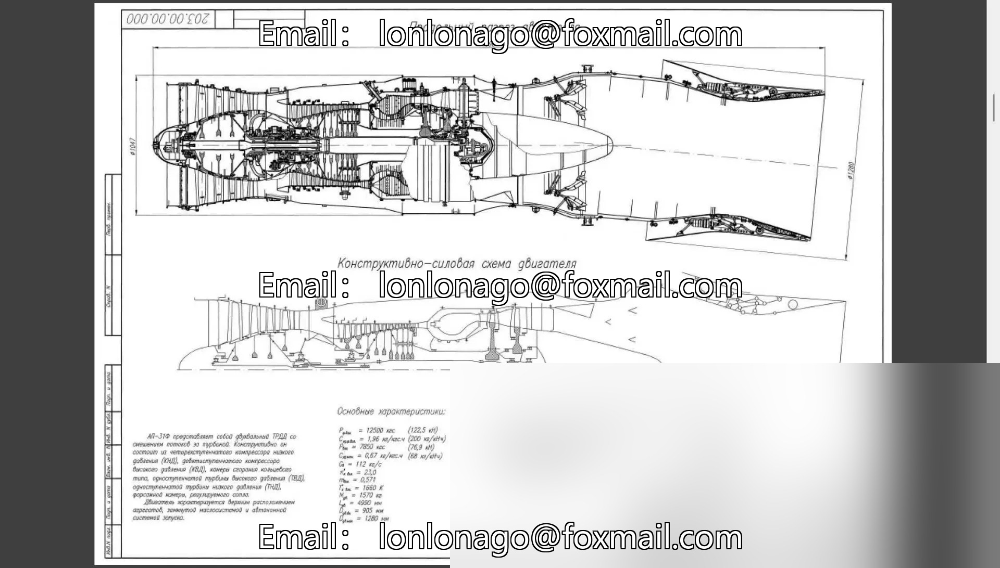
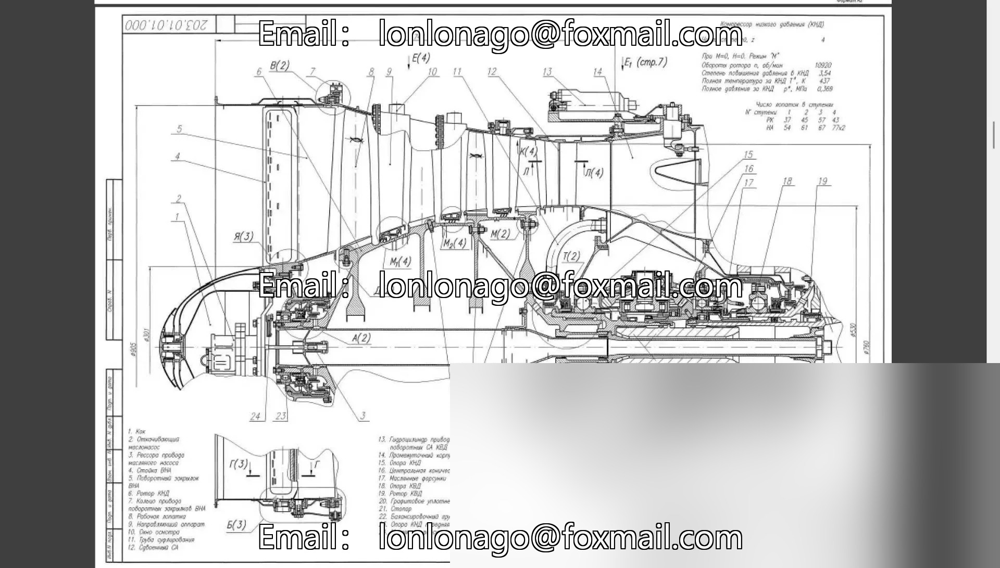
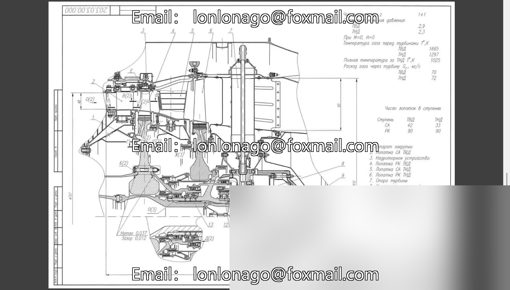

# Moscow Aviation Academy "Saturn" Research and Production Consortium - Part Drawings

## Body

Moscow Aviation Academy "Saturn" Research and Production Consortium - Parts Catalogue, 20 pages covering part and node diagrams of the AL-31F dual-turbine jet engine, and electronic data in original Russian version.
Content covers engine structure, part distribution, system integration, etc., suitable for research and reference for aviation engine major study, maintenance, and repair.
Electronic data, and return upon sale. For direct photo requirements, please chat privately.

The catalog covers AL-31Ф dual-turbine jet engine parts and nodes, including engine structure, part distribution and system integration, in a 20-page Russian original.

<!-- AI_ENRICHED -->

## Images

## Payment

Here is a pay link on Stripe ( https://buy.stripe.com/3cs8yP7sY87d0vu9AB ). Please contact me lonlonago@foxmail.com after funding $89, and I will send you a complete data files , thank you!

